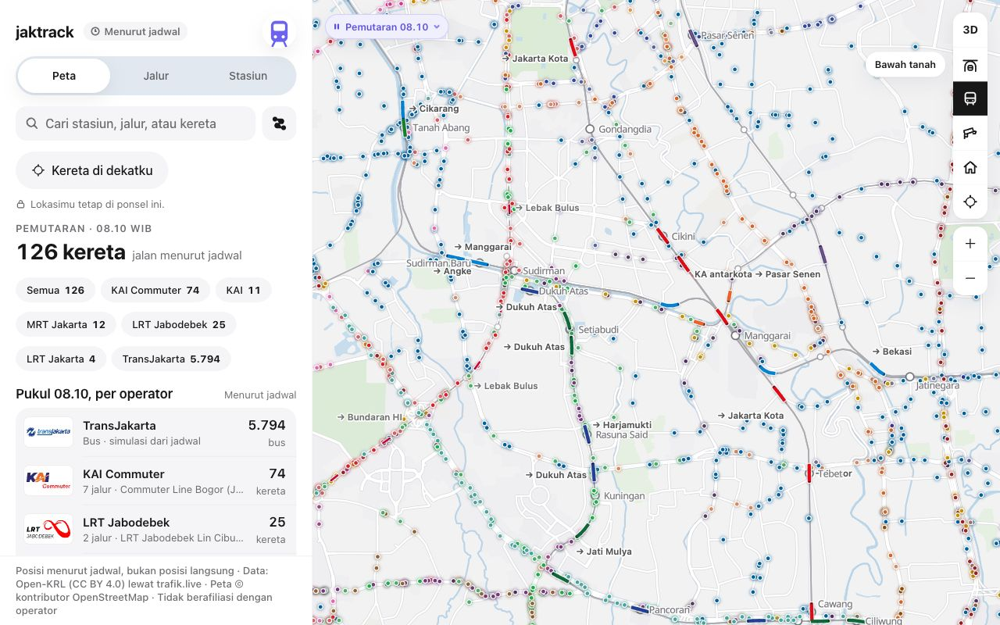
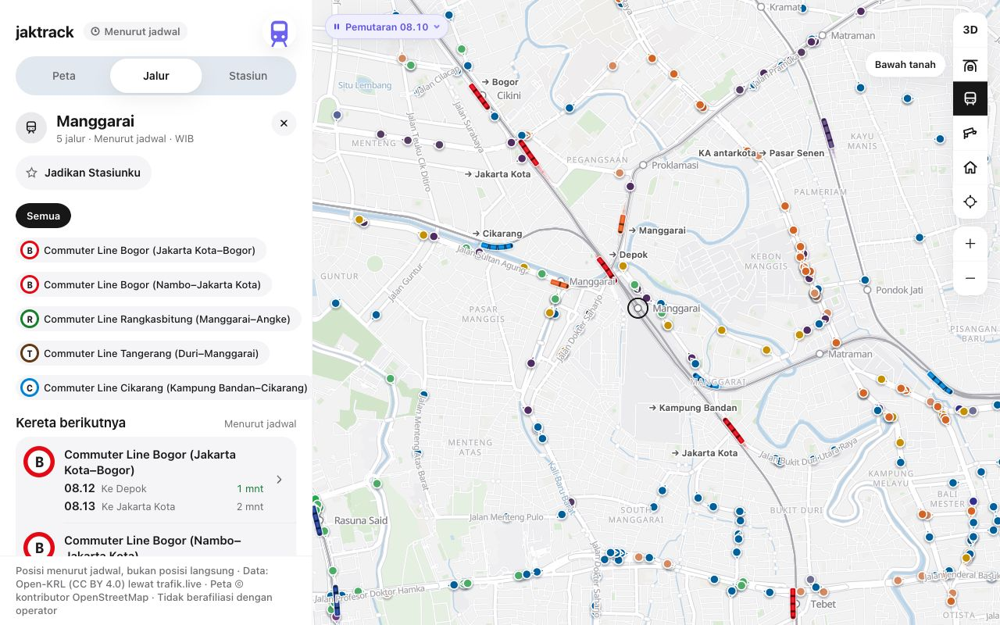
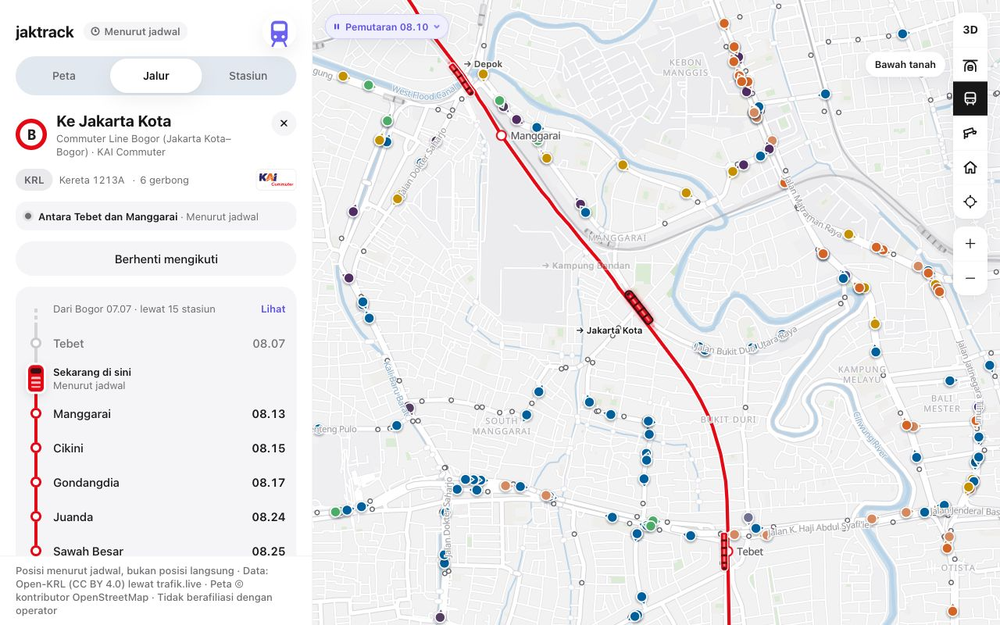
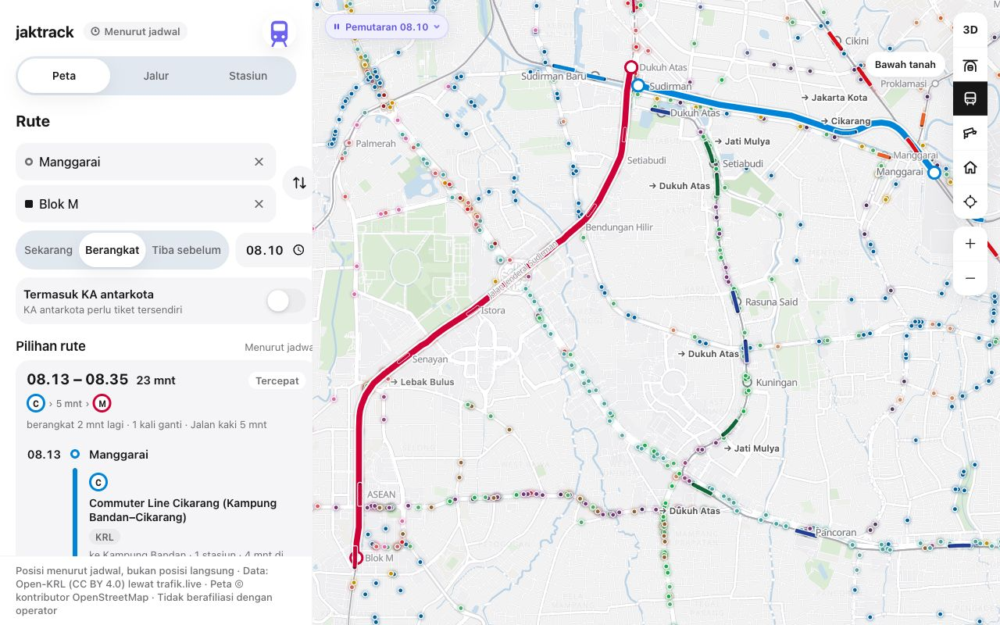
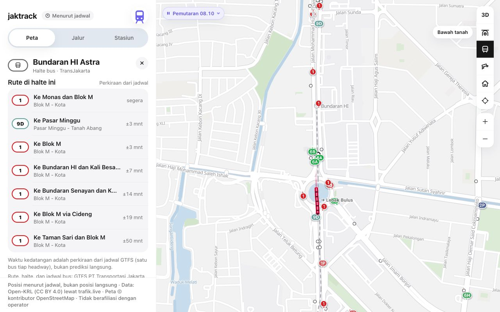
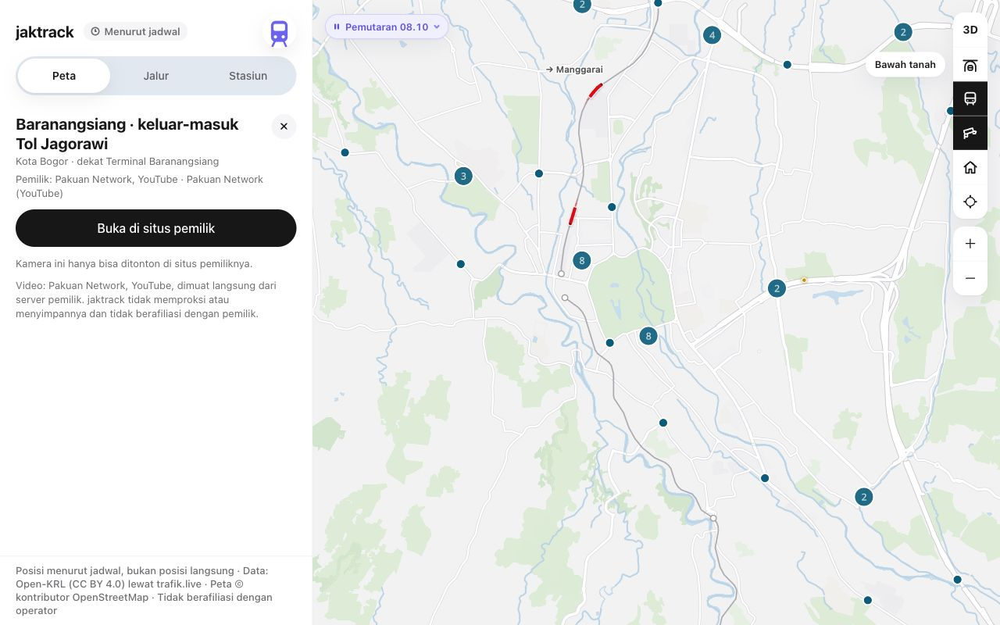
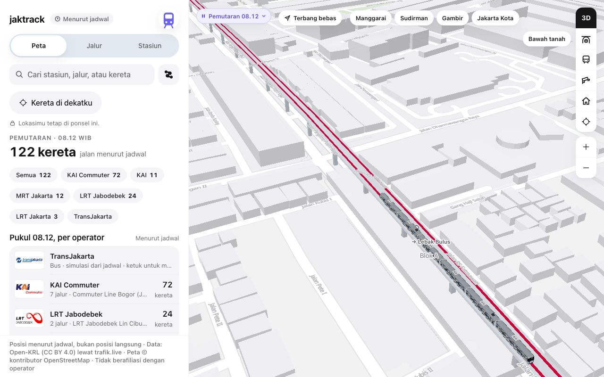
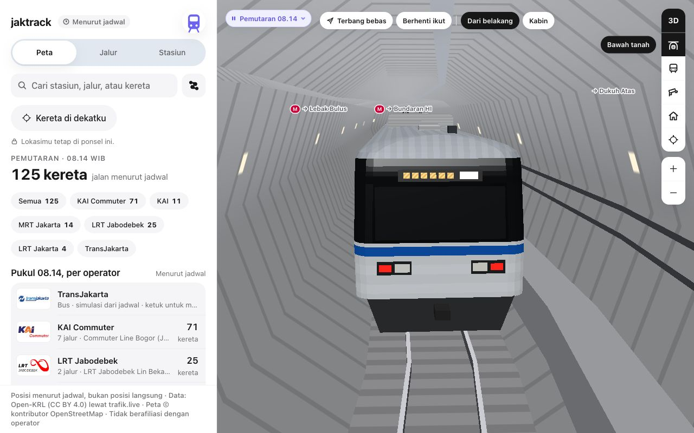
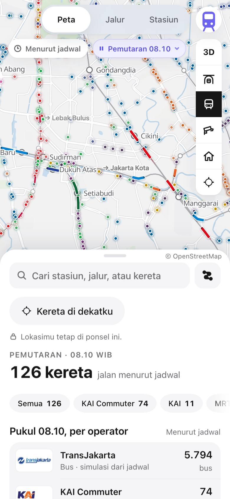

# jaktrack

Peta kereta Jabodetabek di browser: KRL Commuter Line, MRT Jakarta, LRT Jakarta, LRT Jabodebek, dan KA antarkota tampil di posisinya **menurut jadwal**, bersama bus TransJakarta yang disimulasikan dari jadwal GTFS-nya.



> **Status: purwarupa.** Semua posisi dihitung dari jadwal, jadi keterlambatan dan pembatalan tidak terlihat. Bus adalah simulasi yang jumlahnya jauh di atas armada nyata. Kodenya diadaptasi dari [tokyo-rail-twin](https://github.com/lucacadalora/tokyo-rail-twin) (MIT), dan sisa Tokyo masih ada di beberapa tempat (lihat [Keterbatasan](#keterbatasan)).

## Daftar isi

- [Fitur](#fitur)
- [Tangkapan layar](#tangkapan-layar)
- [Menjalankan](#menjalankan)
- [Data](#data)
- [Cara kerja](#cara-kerja)
- [Keterbatasan](#keterbatasan)
- [Dokumen lain](#dokumen-lain)
- [Struktur repo](#struktur-repo)
- [Asal kode dan lisensi](#asal-kode-dan-lisensi)
- [Penafian](#penafian)

## Fitur

Semua butir di bawah sudah dicoba di Chromium (lewat Playwright) terhadap server dev lokal. Catatan ujinya ada di [docs/E2E.md](docs/E2E.md).

**Kereta**

- Di peta 2D tiap kereta bergerak di relnya dengan warna jalur dan label tujuannya. Pada pemutaran Senin 08.10 halaman menghitung 126 kereta di jalan.
- Tab Jalur menyusun jalur per operator, lengkap dengan jumlah kereta yang sedang jalan dan jarak antar-kereta.
- Papan stasiun memuat kereta berikutnya per jalur dan arah, serta kereta pertama dan terakhir.
- Detail kereta memuat semua pemberhentian beserta jamnya, posisi sekarang, dan tombol untuk mengikuti kereta di peta.
- Perencana rute mencari perjalanan dengan pindah jalur, termasuk jalan kaki antarstasiun yang berdekatan. Asal, tujuan, dan jamnya tersimpan di tautan (`#route=from:<id>;to:<id>;dep:0810`), jadi rutenya bisa dibagikan. Sejauh ini baru dicoba dengan satu pasangan, Manggarai ke Blok M.
- Pencarian menemukan stasiun, jalur, nomor kereta, rute bus, dan halte.
- Pemutaran waktu: cip jam di peta memindahkan halaman ke jam lain pada hari layanan yang sama, dan kereta serta bus ikut bergerak.

**3D**

- Di kota 3D, rel ganda digambar sebagai dua pita berwarna jalurnya di antara gedung, dan kereta tiap arah berjalan di relnya sendiri di sisi kanan, sedangkan rel tunggal digambar satu pita. Jumlah rel per ruas berasal dari OpenStreetMap ([docs/REL.md](docs/REL.md)).
- Viaduk dengan dek dan tiang untuk MRT (dari Lebak Bulus sampai dekat ASEAN), LRT Jakarta, LRT Jabodebek, dan KRL antara Jakarta Kota dan Manggarai. Letak ruas layang dan terowongan diambil dari tag OpenStreetMap, sedangkan tinggi viaduk dalam meter adalah perkiraan ([docs/ELEVASI.md](docs/ELEVASI.md)).
- Mode Bawah tanah memperlihatkan terowongan MRT antara Senayan dan Bundaran HI: dua tabung, kotak stasiun, dan skala kedalaman. Dari detail kereta MRT, "Ikut di terowongan" membawa kamera ke belakang kereta atau ke kabinnya.

**Bus TransJakarta (simulasi dari jadwal)**

- Lapisan bus menyala secara bawaan jika data bus sudah dibangun, dan tombol bus di kartu kontrol peta mematikannya. Pada pemutaran Senin 08.10 ada 5.794 bus simulasi di peta.
- Tab Jalur memuat 241 rute dengan saringan jenis layanan (BRT, Non-BRT, Mikrotrans, Transjabodetabek, dan seterusnya), dan saringan itu ikut berlaku untuk bus di peta.
- Lembar halte menyebut rute yang lewat dan kedatangan berikutnya, berlabel "Perkiraan dari jadwal".

**CCTV lalu lintas (opsional)**

- Tombol kamera menampilkan pin kamera, dan panel tiap kamera menyebut pemiliknya dengan "Buka di situs pemilik" sebagai aksi utama. Video diputar di halaman hanya di browser yang memutar HLS sendiri.

**Lainnya**

- Logo operator menandai KAI, KAI Commuter, MRT Jakarta, LRT Jakarta, LRT Jabodebek, dan TransJakarta di daftar per operator, di judul tab Jalur, dan di panel kereta. Lencana kode jalur (B, C, M, dan lainnya) tidak berubah. Logonya milik operator masing-masing, dan sumbernya tercatat di [web/public/logos/SUMBER.md](web/public/logos/SUMBER.md).
- "Kereta di dekatku" meminta lokasi saat tombolnya diketuk, dan lokasinya tidak dikirim ke mana pun. Untuk ponsel atau laptop lain di jaringan yang sama ada `bun run dev:https` ([docs/LOKASI.md](docs/LOKASI.md)). Ini diuji dengan lokasi tiruan di Chrome headless, belum di ponsel sungguhan.
- Gestur touchpad Mac di 2D dan 3D: geser dua jari menggeser peta, cubit untuk zoom di kursor, dan Option + geser untuk memutar atau memiringkan. Roda tetikus tetap zoom ([docs/GESTUR.md](docs/GESTUR.md)). Ujinya memakai event sintetis, belum touchpad fisik.
- Bahasa Indonesia (bawaan) dan Inggris. Navigasi sudah dirapikan pada lebar 320 sampai 1280 px.

Mode luring (service worker) dan Terbang bebas belum diuji dengan data Jakarta; Terbang bebas baru dipastikan bisa mulai tanpa galat konsol. Yang tidak ada sama sekali: posisi langsung (kereta maupun bus), tarif, dan pintu keluar stasiun.

## Tangkapan layar

Diambil 16 November 2026 dari server dev lokal di Chromium, dalam bahasa Indonesia. Jam browser diatur ke Senin 16 November 2026 supaya halaman memakai jadwal hari kerja, lalu halaman diputar ke 08.10 WIB dan dijeda supaya petanya ramai (08.12 untuk viaduk dan 08.14 untuk terowongan). Izin lokasi tidak diberikan.

| | |
|---|---|
| **Tab Jalur.** Jalur per operator dengan logonya, jumlah kereta yang jalan, dan jarak antar-kereta.<br> | **Papan stasiun.** Manggarai dengan lima jalurnya dan kereta berikutnya.<br> |
| **Detail kereta.** KRL 1213A ke Jakarta Kota di antara Tebet dan Manggarai, dengan kamera mengikuti kereta.<br> | **Perencana rute.** Manggarai ke Blok M, berangkat 08.10: KRL ke Sudirman, jalan kaki ke Dukuh Atas, lalu MRT.<br> |
| **Halte TransJakarta.** Bundaran HI Astra: rute yang lewat dan perkiraan kedatangan.<br> | **CCTV.** Pin kamera di Bogor dan panel satu kamera yang hanya bisa ditonton di situs pemiliknya.<br> |
| **Viaduk di 3D.** Kereta MRT di dek viaduk Blok A, dengan dua rel merah di atas dek.<br> | **Terowongan MRT.** Mode Bawah tanah, kamera di belakang kereta ke Bundaran HI di tabung antara Bendungan Hilir dan Setiabudi.<br> |
| **Ponsel 390 × 844.** Peta dengan kereta dan bus, lembar bawah setengah terbuka.<br> | |

## Menjalankan

Butuh [Bun](https://bun.sh) 1.1 ke atas. Perintah `bun run data` juga memakai `unzip` milik sistem (macOS atau Linux).

```bash
bun install
# 1. simpan berkas data kereta trafik.live ke var/src/trafik/ (lihat bagian Data)
bun data-build/elev.mjs --fetch   # sekali saja, opsional: rel OpenStreetMap (±3 MB) untuk viaduk dan jumlah rel
bun run data       # bangun var/static/tokyo/ dari berkas itu, lalu data bus dan CCTV
bun run dev        # buka http://127.0.0.1:4776
```

| Perintah | Guna |
|---|---|
| `bun run dev:https` | Server dev lewat https di semua antarmuka jaringan, dengan sertifikat self-signed di `var/tls/` (butuh `openssl`), supaya "Kereta di dekatku" berfungsi dari perangkat lain di jaringan yang sama ([docs/LOKASI.md](docs/LOKASI.md)) |
| `bun test` | Memeriksa berkas hasil `bun run data` dengan pembaca milik halaman, lalu menguji simulator bus, perhitungan rel, hash rute, pemetaan logo operator, dan pengenal gestur touchpad |
| `bun run build` | Situs statis di `web/dist` (±3,5 MB termasuk salinan terkompresi), bisa disajikan server web mana pun |

Berkas data trafik.live **tidak ada di repo**. Tanpa berkas itu, `bun run data` berhenti dengan pesan yang menyebut berkas yang kurang. Perintah itu menjalankan empat pembangun berurutan:

1. `data-build/jakarta.mjs` membangun jaringan dan jadwal kereta dari `var/src/trafik/asset-krl-*.json`. Jika `var/src/osm/rail.json` ada, lintasan tiap jalur juga digeser ke garis tengah rel OpenStreetMap.
2. `data-build/elev.mjs` menandai ruas layang dan terowongan serta menghitung jumlah rel per ruas dari `var/src/osm/rail.json`. Tanpa berkas itu ia mencetak "Ketinggian dilewati" dan berakhir dengan kode 0, lalu 3D hanya mengenal terowongan MRT.
3. `data-build/bus.mjs` mengunduh GTFS TransJakarta (2,5 MB) sekali ke `var/tmp/gtfs/`; `--fetch` mengunduh ulang. Jika unduhan gagal, data kereta tetap terbangun, perintah berakhir dengan kode galat, dan halaman berjalan tanpa tombol bus.
4. `data-build/cctv.mjs` membaca `var/src/trafik/asset-cctv-*.json` tanpa mengunduh apa pun. Tanpa berkas itu ia mencetak "CCTV dilewati", dan tombol kamera tidak tampil.

## Data

Repo ini hanya berisi kode. Berkas sumber dan hasil bangunnya ada di `var/`, yang tidak di-commit.

### Sumber dan lisensi

| Data | Asal | Lisensi |
|---|---|---|
| Jadwal KRL Commuter Line | [Open-KRL](https://github.com/open-krl/pipeline), dari papan keberangkatan publik kci.id, dikemas trafik.live | CC BY 4.0 |
| Jadwal MRT, LRT Jakarta, LRT Jabodebek, KA antarkota; geometri rel | Dihimpun trafik.live | Tidak dinyatakan |
| Label LRT Jabodebek | Commute (ShioriLabs) | MIT |
| Koordinat stasiun; ruas layang dan terowongan; jumlah rel | Kontributor OpenStreetMap | ODbL |
| Rute, halte, dan jadwal bus | GTFS PT Transportasi Jakarta (`gtfs.transjakarta.co.id`), diunduh langsung dari penerbitnya | Berkasnya tidak memuat pernyataan lisensi |
| Daftar kamera CCTV | Dihimpun trafik.live; stream milik instansi dan operator jalan tol yang tercantum di berkas itu | Tidak dinyatakan |
| Logo operator | Wikimedia Commons, rincian per berkas di [SUMBER.md](web/public/logos/SUMBER.md) | Domain publik (PD-textlogo); mereknya tetap milik operator |
| Peta dasar | Ubin OpenFreeMap © OpenMapTiles, dengan data OpenStreetMap | ODbL untuk datanya; © OpenMapTiles dicantumkan di halaman |

Atribusinya tampil di halaman (Tentang → Data dan kredit) dan wajib dipertahankan.

### Mengambil berkas trafik.live

1. Buka `https://trafik.live/kereta` di browser.
2. Buka DevTools → tab Network, lalu muat ulang halaman.
3. Simpan respons `asset-krl-<hash>.json` (±296 kB) ke `var/src/trafik/`.

Untuk CCTV, lakukan hal yang sama di `https://trafik.live/cctv` dan simpan `asset-cctv-<hash>.json` (±180 kB). Repo ini tidak menyediakan skrip unduh, karena server trafik.live menolak klien selain browser (HTTP 403) dan repo ini tidak mengakalinya.

### Batasan pakai

- `robots.txt` trafik.live melarang pengumpulan konten untuk melatih model atau untuk membangun dan menjual ulang korpus. Pakai berkasnya sebagai masukan lokal dan **jangan disebarkan ulang**.
- Bagian yang lisensinya tidak dinyatakan (jadwal MRT, LRT, dan KA antarkota, geometri rel, daftar kamera) belum jelas boleh dipakai ulang. Sebelum menayangkan jaktrack untuk umum, minta izin pengelolanya atau ganti dengan sumber terbuka. Untuk jadwal KRL saja, Open-KRL menerbitkan GTFS-nya langsung dengan CC BY 4.0.
- Syarat pakai tiap pemilik kamera CCTV belum dicek. Video tidak diproksi, direkam, atau disimpan; halaman memuatnya langsung dari server pemilik.
- Logo operator dipakai hanya untuk menandai operator, tidak sebagai logo jaktrack. Status domain publik di Commons tidak menghapus hak merek.

### Hasil bangun

Angka di bawah berubah jika berkas sumbernya diperbarui.

- Dari berkas kereta bertanggal bangun 12 Oktober 2026: 16 jalur (12 jalur sumber, jalur bercabang dipecah), 207 entri stasiun dalam 50 kelompok pindah jalur, dan 2.622 perjalanan (2.133 pada hari kerja, 1.879 pada akhir pekan).
- Dari rel OpenStreetMap per 14 November 2026: MRT layang 8,8 km dan terowongan 5,5 km; LRT Jakarta layang 11,5 km; LRT Jabodebek layang 23,8 km (Cibubur) dan 27,3 km (Bekasi); KRL Lin Bogor layang 10,4 km antara Jakarta Kota dan Manggarai.
- Dari GTFS TransJakarta yang diperbarui 13 November 2026: 241 rute, 694 pola trip, dan 7.875 halte, dalam `bus-v1.json` sebesar 1,65 MB (0,46 MB dengan brotli).
- Dari berkas CCTV yang diperiksa penyusunnya 13 November 2026: 478 kamera dan 594 sudut, 564 di antaranya stream HLS. Delapan kamera yang ditandai mati (semuanya Dishub Depok) tidak ikut dibangun.

## Cara kerja

```
asset-krl-*.json ─► data-build/jakarta.mjs ─► var/static/tokyo/ ─► web/ (MapLibre GL JS)
GTFS TransJakarta ─► data-build/bus.mjs   ─►   network-v1.json      peta 2D, kota 3D, papan,
rail.json (OSM)   ─► data-build/elev.mjs  ─►   tt-v1/, bus-v1.json  rute, pencarian
```

- **Kereta.** Pembangun menyusun graf rel, mencari lintasan tiap kereta di antara pemberhentiannya, lalu menulis jadwal yang dipotong per jam per kalender. Halaman memuat jam yang sedang berjalan dan menaruh tiap kereta di relnya dengan interpolasi di antara dua pemberhentian, setiap frame, langsung dari jam.
- **Bus.** Untuk tiap pola trip, satu bus berangkat tiap headway selama jendela frekuensinya, lalu bergerak di sepanjang bentuk rute menurut waktu tiba di tiap halte (`web/src/tokyo/buses/sim.js`, tanpa permintaan jaringan).
- **Hari layanan** berganti pukul 03.00 WIB untuk kereta dan bus, jadi perjalanan lewat tengah malam tetap milik hari sebelumnya.
- **Server.** Tidak ada server selain penyaji berkas statis. Peta dasar dari OpenFreeMap, tanpa kunci API.

## Keterbatasan

**Jadwal dan posisi**

- Posisi dihitung dari jadwal, jadi keterlambatan dan pembatalan tidak terlihat.
- Hari libur nasional belum ada. Hanya Sabtu dan Minggu yang memakai jadwal akhir pekan, dan jadwal KRL hari Sabtu memakai tangkapan hari Minggu karena sumbernya tidak punya tangkapan Sabtu.
- Jalur bercabang tampil sebagai beberapa jalur, dan jalur yang berbagi rel digambar bertumpuk. Di 3D, rel bersama hanya memperlihatkan warna jalur yang terakhir di daftar.
- Stasiun bernama sama dengan id berbeda (misalnya Dukuh Atas MRT dan LRT) belum digabung menjadi satu titik pindah.
- Label arah di papan stasiun MRT terasa terbalik: "Arah luar kota" ke Bundaran HI dan "Arah pusat" ke Lebak Bulus.
- Daftar "Pilih stasiunmu" memakai id yang bergantung pada urutan jalur hasil bangun, jadi bisa bergeser jika data berubah.

**3D, rel, dan terowongan** (rinciannya di [docs/REL.md](docs/REL.md) dan [docs/ELEVASI.md](docs/ELEVASI.md))

- Angka tinggi dan kedalaman adalah **perkiraan**: terowongan 18 m di semua stasiun (digambar 5× lebih dalam di mode Bawah tanah), viaduk 12 m ditambah 5 m per tingkat tag `layer` di atas 2. Yang bersumber hanya letak ruas layang dan terowongan serta urutan tingkatnya.
- Bentuk terowongan MRT adalah asumsi: dua tabung perisai kembar dengan ukuran bawaan kode asal, mengikuti garis tengah yang sama, dan baru terbaca sebagai dua tabung dari dekat.
- Di ruas tiga rel atau lebih, rel yang dipakai tiap jalur tidak diketahui, jadi kereta ditaruh di sepasang rel terdekat. Pindah rel (wesel) di stasiun ujung tidak dimodelkan.
- Viaduk digambar di garis tengah rel OpenStreetMap sebagai satu dek, tanpa bangunan peron. Jembatan KRL yang lebih pendek dari 300 m tetap di permukaan. Di bawah zoom 17,5, kereta, jarak rel, dan dek digambar lebih lebar dari aslinya.
- Di mode Bawah tanah, kereta di ruas layang digambar di permukaan karena viaduk dan gedung disembunyikan di mode itu.

**Bus TransJakarta**

- Jumlah bus jauh di atas kenyataan. GTFS dibaca apa adanya, dan hasilnya 5.834 sampai 6.049 bus pada pukul 08.00, 13.00, dan 20.00 hari Jumat dan Sabtu (GTFS 13 November 2026). Sebagai pembanding, trafik.live teramati menampilkan sekitar 3.100 bus pada Sabtu malam. Sebab pasti selisihnya belum diketahui. Yang terukur, Mikrotrans menyumbang sekitar separuhnya (2.972 dari 5.867 pada Sabtu 13.00).
- Headway adalah satu-satunya jadwal, jadi letak tiap bus di antara dua keberangkatan adalah anggapan. Bus tidak berhenti di halte dan tidak menunggu di terminal.
- Kedatangan di halte dihitung dari headway dan waktu tempuh GTFS yang sama dengan simulasi, jadi sifatnya perkiraan. Hari libur nasional memakai jadwal hari biasanya.
- Halte bernama sama (dua sisi jalan, beberapa peron) tampil sebagai entri terpisah. Lembar rute menggambar semua pola trip rute itu sekaligus, sehingga rute bervarian seperti koridor 1 tampak bercabang.
- Jika bus berada tepat di atas pin kamera, ketukan di titik itu membuka lembar bus.
- Kinerja: 60 fps dengan 5.867 bus di Chromium pada Apple M5. Belum diukur di ponsel.

**CCTV**

- Tidak semua stream menjawab. Dari lima kamera yang dicoba pada 15 November 2026, empat membalas daftar putar, sedangkan `jmlive.jasamarga.com` (195 dari 564 sudut HLS) membalas kosong. Sisanya tidak diuji.
- Kamera YouTube dan Tangerang hanya berupa tautan, karena sumbernya halaman sematan dan halaman ini tidak memakai `<iframe>`.
- Server dev menambahkan 19 origin stream ke `media-src` CSP. Server produksi harus mengirim CSP yang sama sendiri.
- Koordinat pin diambil apa adanya dari berkas sumber, dan ketepatannya tidak diperiksa.

**Tampilan dan perangkat**

- Belum diuji: browser selain Chromium, ponsel sungguhan, touchpad fisik, mode https di ponsel, dan mode luring.
- Lebar 640 sampai 899 px tegak masih memakai tata letak ponsel yang melebar. Di desktop, urutan Tab dimulai dari peta baru ke panel. Di ponsel, fokus keyboard ke chip di dalam lembar yang sedang turun bisa jatuh di luar layar.
- Di desktop, isi panel perencana rute 6 px lebih lebar dari panelnya, sehingga tepi kanannya sedikit terpotong (terlihat di tangkapan perencana rute).
- Sisa Tokyo di antarmuka: penjelasan jenis kereta Jepang di Tentang, teks bahasa Jepang, dan teks awal tombol bus di `web/tokyo.html` ("Show live Toei buses", diganti begitu halaman berjalan). Nama `tokyo` pada folder, berkas, dan jenis data adalah bawaan kode asal dan sengaja belum diganti.
- Uji bawaan tokyo-rail-twin dihapus karena mengunci perilaku Tokyo (zona waktu JST, data Tokyo).

## Dokumen lain

| Dokumen | Isi |
|---|---|
| [docs/E2E.md](docs/E2E.md) | Hasil uji end-to-end manual lewat browser, termasuk audit navigasi |
| [docs/REL.md](docs/REL.md) | Jumlah rel per ruas dan sisi jalan kereta, dengan sumber |
| [docs/ELEVASI.md](docs/ELEVASI.md) | Ruas layang dan terowongan per jalur, angka perkiraan, dan sumbernya |
| [docs/LOKASI.md](docs/LOKASI.md) | "Kereta di dekatku" dari perangkat lain lewat mode https server dev |
| [docs/GESTUR.md](docs/GESTUR.md) | Gestur peta untuk touchpad, tetikus, dan layar sentuh |
| [KNOWLEDGE.md](KNOWLEDGE.md) | Catatan riset cara kerja trafik.live, tiap butir ditandai teramati atau dugaan |
| [web/public/logos/SUMBER.md](web/public/logos/SUMBER.md) | Sumber, pemilik merek, dan status lisensi tiap logo operator |

## Struktur repo

| Jalur | Isi |
|---|---|
| `data-build/` | Pembangun data kereta (`jakarta.mjs`), ketinggian dan jumlah rel (`elev.mjs`, `snap.mjs`), bus (`bus.mjs`), dan CCTV (`cctv.mjs`), masing-masing dengan ujinya |
| `web/tokyo.html`, `web/src/tokyo/` | Halaman dan modul fiturnya: peta, papan, pencarian, rute, i18n, logo operator (`logos.js`) |
| `web/src/tokyo/buses/` | Lapisan bus, simulator jadwal (`sim.js`), daftar rute dan lembar halte (`browse.js`) |
| `web/src/layers/city3d/` | Kota 3D, viaduk, terowongan, dan kamera |
| `web/src/map/`, `web/src/app/` | Mesin peta, gestur touchpad, dan pembantu antarmuka |
| `web/public/` | Ikon, manifes, `LICENSES.txt`, dan logo operator di `logos/` |
| `web/build.mjs`, `web/dev-server.mjs` | Bundel esbuild dan server dev |
| `docs/` | Dokumen di atas dan tangkapan layar README (`docs/media/`) |
| `third_party/tokyo-rail-twin/` | Lisensi dan pemberitahuan kode asal |

## Asal kode dan lisensi

- Kode di `web/` diadaptasi dari [tokyo-rail-twin](https://github.com/lucacadalora/tokyo-rail-twin) (MIT), yang sebagian diadaptasi dari [Mini Tokyo 3D](https://github.com/nagix/mini-tokyo-3d) karya Akihiko Kusanagi (MIT). Teks lisensi dan pemberitahuannya ada di `third_party/tokyo-rail-twin/` dan `web/public/LICENSES.txt`.
- Repo jaktrack sendiri belum mencantumkan berkas lisensi.
- Data dan logo tunduk pada lisensi dan hak merek sumbernya masing-masing (lihat [Data](#data)).

## Penafian

jaktrack tidak berafiliasi dengan trafik.live, tokyo-rail-twin, Open-KRL, KAI, KAI Commuter, MRT Jakarta, LRT Jakarta, LRT Jabodebek, TransJakarta, pemilik kamera CCTV, atau instansi pemilik data mana pun. Logo operator tetap milik pemiliknya. Waktu yang tampil adalah waktu rencana. Untuk jadwal resmi dan gangguan layanan, pakai kanal resmi operator.
