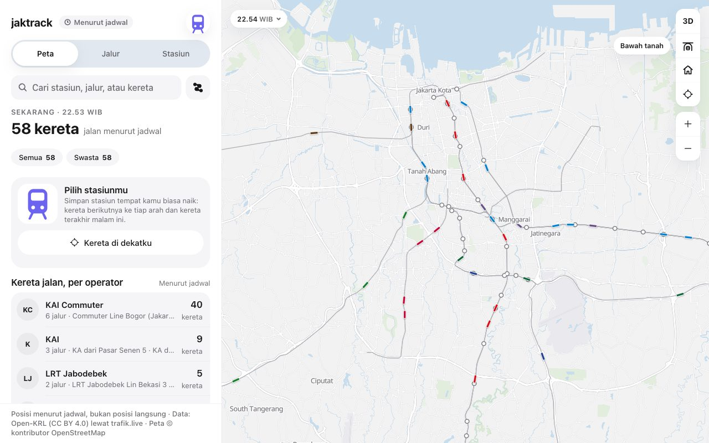
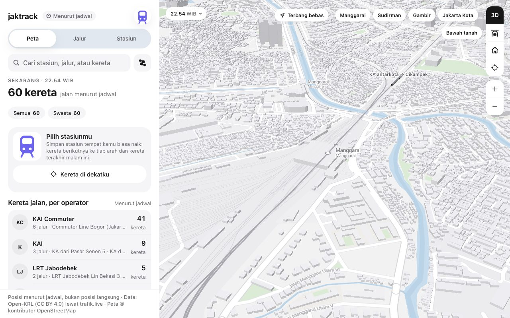

# jaktrack

Peta kereta Jabodetabek di browser: KRL Commuter Line, MRT Jakarta, LRT Jakarta, LRT Jabodebek, dan KA antarkota, masing-masing di posisi **menurut jadwalnya saat ini**.



> **Status: purwarupa.** Posisi kereta dihitung dari jadwal, **bukan posisi asli**. Keterlambatan dan pembatalan tidak terlihat.
> Halamannya adalah adaptasi [tokyo-rail-twin](https://github.com/lucacadalora/tokyo-rail-twin) (MIT) untuk Jakarta, dan belum seluruhnya disesuaikan (lihat [Yang belum disesuaikan](#yang-belum-disesuaikan)).

## Daftar isi

- [Tangkapan layar](#tangkapan-layar)
- [Fitur](#fitur)
- [Menjalankan](#menjalankan)
- [Data](#data)
- [Cara kerja](#cara-kerja)
- [Struktur repo](#struktur-repo)
- [Yang belum disesuaikan](#yang-belum-disesuaikan)
- [Riset trafik.live](#riset-trafiklive)
- [Lisensi dan asal kode](#lisensi-dan-asal-kode)
- [Penafian](#penafian)

## Tangkapan layar

Diambil 14 November 2026 sekitar pukul 22.55 WIB dari server dev lokal, dalam bahasa Indonesia.

| | |
|---|---|
| **Daftar jalur.** Tiap jalur dengan jumlah kereta yang sedang jalan dan jarak antar-kereta.<br> | **Papan stasiun.** Kereta berikutnya dari Manggarai per jalur dan arah, termasuk kereta terakhir.<br> |
| **Detail kereta.** KRL 1456 tujuan Depok: posisi sekarang, semua stasiun berikutnya, dan kamera yang mengikuti kereta.<br> | **Kota 3D.** Stasiun Manggarai dengan gedung 3D dan kereta di relnya.<br> |
| **Tentang.** Penjelasan "menurut jadwal", pilihan bahasa, serta sumber dan kredit data.<br> | **Ponsel.** Tata letak lembar bawah pada layar 390 × 844.<br> |

## Fitur

Sudah dicoba di browser dan berjalan:

- **Peta 2D** dengan setiap kereta bergerak di relnya, berwarna sesuai jalur. Sekitar 60–85 kereta pada malam hari.
- **Bus TransJakarta (simulasi dari jadwal)**: menyala secara bawaan bila data bus sudah dibangun; tombol bus di kartu kontrol peta mematikan atau menyalakannya, dan pilihan itu diingat browser. Beranda memuat baris TransJakarta dengan jumlah bus pada jam halaman (tidak dijumlahkan ke angka kereta). Tiap bus bergerak di sepanjang rutenya dan bisa diketuk untuk melihat rute, tujuan, dan halte berikutnya. Ini bukan posisi langsung; lihat [keterbatasannya](#bus-transjakarta-simulasi-bukan-posisi-langsung).
- **Rute dan halte bus**: di tab Jalur ada bagian TransJakarta berisi 241 rute (koridor BRT lebih dulu) dengan headway saat ini dan saringan jenis layanan; saringan itu juga berlaku untuk bus di peta. Mengetuk rute menggambar rute, halte, dan busnya. Mengetuk halte (di peta pada zoom dekat, dari lembar rute, atau dari pencarian) membuka rute yang lewat beserta kedatangan berikutnya, berlabel "perkiraan dari jadwal". Pencarian menemukan rute dan halte bus.
- **CCTV lalu lintas (opsional)**: tombol kamera di kartu kontrol peta menampilkan pin kamera. Ketuk pin untuk melihat nama, lokasi, pemilik, dan sudut kamera, dengan tautan "Buka di situs pemilik" sebagai aksi utama. Video diputar di dalam halaman hanya di browser yang memutar HLS sendiri; lihat [keterbatasannya](#cctv-opsional-dan-milik-pihak-lain).
- **Daftar jalur** dan **ringkasan per operator**.
- **Papan stasiun**: kereta berikutnya tiap arah, kereta pertama dan terakhir.
- **Detail kereta**: semua pemberhentian, posisi sekarang, dan mode mengikuti kereta.
- **Pencarian** stasiun, jalur, dan nomor kereta.
- **Kota 3D** dengan titik terbang ke Manggarai, Sudirman, Gambir, dan Jakarta Kota.
- **Bawah tanah** (tombol di kanan atas): terowongan MRT Senayan–Bundaran HI, kotak stasiunnya, dan kereta di dalamnya, termasuk "Ikut di terowongan" dari detail kereta MRT.
- **Bahasa** Indonesia (bawaan) dan Inggris.
- **Tata letak ponsel** dan desktop.

Ada di kode bawaan tokyo-rail-twin tetapi **belum diuji dengan data Jakarta**: perencana rute, pemutaran ulang waktu, terbang bebas, mode luring (service worker), dan "kereta di dekatku".

Tidak ada: posisi langsung (kereta maupun bus), pintu keluar stasiun, tarif.

## Menjalankan

Butuh [Bun](https://bun.sh) 1.1 ke atas.

```bash
bun install
# 1. simpan berkas data kereta ke var/src/trafik/ (lihat bagian Data)
bun data-build/elev.mjs --fetch   # 2a. sekali saja (opsional): unduh rel OpenStreetMap (±3 MB) untuk ketinggian rel
bun run data    # 2. bangun var/static/tokyo/ dari berkas itu, lalu unduh GTFS TransJakarta dan bangun data bus
bun run dev     # 3. buka http://127.0.0.1:4776
```

Perintah lain:

| Perintah | Guna |
|---|---|
| `bun test` | Memeriksa berkas hasil `bun run data` dengan pembaca milik halaman web |
| `bun run build` | Situs statis di `web/dist` (±3,3 MB), bisa disajikan server web mana pun |

Tanpa langkah 1 dan 2, `bun run data` berhenti dengan pesan yang menyebut berkas yang kurang.

`bun run data` menjalankan empat pembangun berurutan: kereta (`data-build/jakarta.mjs`), ketinggian rel (`data-build/elev.mjs`), bus (`data-build/bus.mjs`), lalu CCTV.

Pembangun ketinggian membaca `var/src/osm/rail.json` (way rel OpenStreetMap se-Jabodetabek dengan tag `bridge`/`tunnel`/`layer`) dan menulis `elev-v1.json`: per jalur, ruas mana yang layang dan mana yang terowongan. Berkas OSM itu diunduh sekali dengan `bun data-build/elev.mjs --fetch` (satu kueri Overpass). Bila berkasnya tidak ada, pembangun mencetak "Ketinggian dilewati" dan berakhir dengan kode 0; tampilan 3D lalu hanya mengenal terowongan MRT dan semua ruas lain digambar di permukaan. Metode, sumber per jalur, dan batasannya: [docs/ELEVASI.md](docs/ELEVASI.md).

Pembangun bus mengunduh GTFS (2,5 MB) sekali dan menyimpannya di `var/tmp/gtfs/`; `bun data-build/bus.mjs --fetch` mengunduh ulang. Bila unduhan gagal, data kereta tetap terbangun, perintah berakhir dengan kode galat dan pesan yang menyebut sebabnya, dan halaman berjalan tanpa tombol bus. Pembangun bus memakai perintah `unzip` sistem (macOS/Linux).

Pembangun terakhir, `data-build/cctv.mjs`, berjalan paling akhir dan hanya mengubah berkas lokal (tidak mengunduh apa pun). Bila `var/src/trafik/asset-cctv-*.json` tidak ada, ia mencetak "CCTV dilewati" dan berakhir dengan kode 0; tombol kamera lalu tidak tampil.

## Data

**Repo ini hanya berisi kode.** Berkas data tidak ikut di-commit (`var/` ada di `.gitignore`).

### Sumber

Satu berkas: `asset-krl-*.json` (±296 kB) yang dimuat halaman `trafik.live/kereta`. Isinya:

| Bagian | Asal menurut metadata berkas | Lisensi |
|---|---|---|
| Jadwal KRL Commuter Line | [Open-KRL](https://github.com/open-krl/pipeline), dari papan keberangkatan publik kci.id | CC BY 4.0 |
| Jadwal MRT, LRT Jakarta, LRT Jabodebek, KA antarkota | Dihimpun trafik.live | Tidak dinyatakan |
| Label LRT Jabodebek | Commute (ShioriLabs) | MIT |
| Koordinat stasiun | Kontributor OpenStreetMap | ODbL |
| Ketinggian rel (layang, terowongan) | Tag `bridge`/`tunnel`/`layer` way rel, kontributor OpenStreetMap, lewat Overpass API | ODbL |
| Geometri rel | Tidak dinyatakan | Tidak dinyatakan |

Bus memakai sumber kedua, diunduh langsung dari penerbitnya: **GTFS PT Transportasi Jakarta** (`https://gtfs.transjakarta.co.id/files/file_gtfs.zip`): rute, halte, bentuk rute, dan jadwal berbasis frekuensi. Berkas itu tidak memuat pernyataan lisensi. Tidak ada data bus yang diambil dari trafik.live.

### Cara mengambil

1. Buka `https://trafik.live/kereta` di browser.
2. Buka DevTools → tab Network, muat ulang halaman.
3. Simpan respons `asset-krl-<hash>.json` ke `var/src/trafik/`.

Tidak ada skrip unduh. Server trafik.live menolak klien selain browser (HTTP 403), dan repo ini tidak menyediakan alat untuk mengakalinya.

### Batasan pakai

- `robots.txt` trafik.live melarang pengumpulan konten untuk melatih model atau membangun dan menjual ulang korpus. Pakai berkas itu sebagai masukan lokal dan **jangan sebarkan ulang**.
- Bagian yang lisensinya tidak dinyatakan (jadwal MRT/LRT/KA antarkota dan geometri rel) belum jelas boleh dipakai ulang. Sebelum menayangkan jaktrack untuk umum, minta izin pengelolanya atau ganti dengan sumber terbuka.
- Untuk jadwal KRL saja, Open-KRL menerbitkan GTFS-nya langsung dengan lisensi CC BY 4.0.
- Atribusi tampil di halaman (Tentang → Data dan kredit) dan wajib dipertahankan.

### CCTV lalu lintas (opsional)

Sumber ketiga, juga berkas lokal: `asset-cctv-*.json` (±180 kB) yang dimuat halaman `trafik.live/cctv`, disimpan dengan cara yang sama ke `var/src/trafik/`. Isinya daftar kamera Jabodetabek (nama, koordinat, URL stream, dan halaman pemiliknya) yang dihimpun trafik.live; berkas itu tidak memuat pernyataan lisensi. Stream-nya sendiri milik instansi dan operator jalan tol yang tercantum di bagian `sources` berkas itu:

| Kode | Pemilik menurut berkas | Halaman pemilik |
|---|---|---|
| `dki` | Pemprov DKI Jakarta | jakcctv.jakarta.go.id/publik |
| `tol` | Badan usaha jalan tol (lewat BPJT Kementerian PU) | bpjt.pu.go.id/cctv |
| `jm`, `jtd`, `cct` | Jasa Marga, Jakarta Tollroad Development, Cimanggis Cibitung Tollways | binamarga.pu.go.id, jtd.co.id, cct.co.id |
| `bm` | Ditjen Bina Marga, Kementerian PU | binamarga.pu.go.id/cctv-non-tol |
| `bks` | Pemkot Bekasi | bekasikota.go.id/cctv |
| `bgr` | Pemkot Bogor | bsw.kotabogor.go.id/cctv |
| `tgr` | DPUPR Kota Tangerang (SIPANTAU) | sipantau.dpuprkotang.info |
| `dpk` | Dishub Kota Depok | dishub.depok.go.id/cctv |
| `pkn` | Pakuan Network (YouTube) | youtube.com/@PakuanNetwork |

Karena itu berkas sumber dan hasil bangunnya (`var/static/tokyo/cctv-v1.json`) hanya ada di `var/` dan tidak di-commit; repo hanya berisi kode pengubahnya. Batasan pakai di atas berlaku juga untuk berkas ini, dan syarat pakai tiap pemilik kamera **belum dicek**: minta izin sebelum menayangkan lapisan ini untuk umum.

### Hasil bangun

`bun run data` menghasilkan, dari berkas bertanggal bangun 12 Oktober 2026:

| | Jumlah |
|---|---|
| Jalur | 16 (dari 12 jalur sumber; jalur bercabang dipecah) |
| Stasiun | 207 entri, 50 kelompok pindah jalur |
| Perjalanan | 2.622: 2.133 pada hari kerja, 1.879 pada akhir pekan |

Dari rel OpenStreetMap per 14 November 2026, `elev-v1.json` (1,4 kB) memuat 16 jalur: MRT layang 8,8 km dan terowongan 5,5 km; LRT Jakarta layang 11,5 km; LRT Jabodebek layang 23,8 km (Cibubur) dan 27,3 km (Bekasi); KRL Lin Bogor layang 10,4 km (Jakarta Kota–Manggarai). Hasil bangun ini turunan data OpenStreetMap (ODbL), jadi hanya ada di `var/` dan tidak di-commit. Rinciannya di [docs/ELEVASI.md](docs/ELEVASI.md).

Dari GTFS TransJakarta yang diperbarui 13 November 2026, pembangun bus (±1,5 detik) menghasilkan `bus-v1.json` (1,65 MB; 0,46 MB dengan brotli):

| | Jumlah |
|---|---|
| Rute | 241 |
| Pola trip (masing-masing dengan bentuk rute dan frekuensinya) | 694 |
| Halte | 7.875 |

Dari berkas CCTV yang diperiksa penyusunnya 13 November 2026, `cctv-v1.json` (176 kB):

| | Jumlah |
|---|---|
| Kamera | 478: tol 365, Bogor 39, Tangerang 25, DKI 21, Bekasi 21, Pakuan Network 4, Bina Marga 3 |
| Sudut kamera | 594: 564 dengan stream HLS, 30 tautan saja (Tangerang dan YouTube) |
| Host stream (masuk ke CSP) | 19 |

Delapan kamera yang ditandai mati di berkas sumber (semuanya Dishub Depok) tidak ikut dibangun.

Angka ini berubah bila berkas sumbernya diperbarui.

## Cara kerja

```
asset-krl-*.json ─► data-build/jakarta.mjs ─► var/static/tokyo/ ─► web/ (MapLibre GL JS)
  (lokal, tidak        graf rel, lintasan,        network-v1.json     peta 2D, kota 3D,
   di-commit)          jadwal per jam             tt-v1/<kalender>/   papan, pencarian
```

**Pembangun data** (`data-build/jakarta.mjs`):

1. Membaca jalur, stasiun, potongan rel, pola pemberhentian, dan kereta dari berkas sumber. Waktu di sumber berselang 30 detik.
2. Menyusun graf rel, lalu mencari lintasan tiap kereta di antara pemberhentiannya (jalur terpendek).
3. Memecah tiap jalur sumber menjadi lintasan lurus. Jalur Bogor, misalnya, menjadi "Jakarta Kota–Bogor" dan "Nambo–Jakarta Kota".
4. Menulis jaringan (`network-v1.json`) dan jadwal yang dipotong per jam per kalender (`tt-v1/`), dalam format yang dibaca kode web.

**Pembangun bus** (`data-build/bus.mjs`):

1. Membaca `trips`, `stop_times`, `shapes`, `frequencies`, `routes`, `stops`, dan `calendar` dari GTFS. Layanan yang masa berlakunya sudah lewat dibuang saat bangun; feed ini tidak punya `calendar_dates`.
2. Menempatkan tiap halte di sepanjang bentuk rutenya tanpa pernah mundur, supaya rute pulang-pergi dan rute melingkar tidak salah lintasan.
3. Menulis `bus-v1.json` dalam format lapisan bus bawaan kode asal (`web/src/tokyo/buses/pack.js`), ditambah bagian `sim` berisi kalender dan jadwal frekuensi apa adanya, lalu mendaftarkannya di `packs.json`.

**Simulasi bus** (`web/src/tokyo/buses/sim.js`, berjalan di browser tanpa permintaan jaringan): untuk tiap pola trip, satu bus berangkat tiap headway selama jendela frekuensinya, lalu bergerak di sepanjang bentuk rute menurut waktu tiba di tiap halte. Hari layanan berganti pukul 03.00 WIB, sama dengan kereta: keberangkatan pukul 00.00–02.59 memakai jenis hari sebelumnya.

**Halaman web** (`web/`):

- Memuat jaringan dan jadwal jam berjalan, lalu jam berikutnya sesuai kebutuhan.
- Menaruh tiap kereta di relnya dengan menginterpolasi di antara dua pemberhentian, setiap frame, langsung dari jam (tidak diakumulasi).
- Hari layanan berganti pukul 03.00 WIB; kereta lewat tengah malam tetap milik hari sebelumnya.
- Tidak ada server selain penyaji berkas statis. Peta dasar dari OpenFreeMap, tanpa kunci API.

## Struktur repo

| Jalur | Isi |
|---|---|
| `data-build/jakarta.mjs` | Pembangun data Jakarta |
| `data-build/jakarta.test.mjs` | Uji berkas hasil bangun |
| `data-build/elev.mjs`, `elev.test.mjs` | Pembangun ketinggian rel dari tag OpenStreetMap, dan ujinya |
| `data-build/bus.mjs` | Pembangun data bus dari GTFS TransJakarta |
| `data-build/bus.test.mjs` | Uji simulator bus dan berkas hasil bangun bus |
| `web/src/tokyo/buses/` | Lapisan bus (WebGL), simulator jadwal `sim.js`, daftar rute dan lembar halte `browse.js` |
| `web/tokyo.html`, `web/src/tokyo/` | Halaman dan modul fiturnya (peta, papan, pencarian, rute, i18n) |
| `web/src/layers/city3d/` | Kota 3D, bawah tanah, kamera |
| `web/src/map/`, `web/src/app/` | Mesin peta dan pembantu antarmuka |
| `web/build.mjs`, `web/dev-server.mjs` | Bundel esbuild dan server dev |
| `docs/media/` | Tangkapan layar README |
| `docs/ELEVASI.md` | Riset ketinggian rel per jalur, dengan sumber |
| `docs/E2E.md` | Hasil uji end-to-end manual lewat browser |
| `third_party/tokyo-rail-twin/` | Lisensi dan pemberitahuan kode asal |
| `KNOWLEDGE.md` | Catatan riset trafik.live |

Nama `tokyo` pada folder, berkas, dan jenis berkas data (`tokyo-network`) adalah bawaan kode asal dan sengaja belum diganti.

## Yang belum disesuaikan

- **Sisa Tokyo di antarmuka.** Penjelasan jenis kereta Jepang di halaman Tentang dan teks bahasa Jepang.
- **Kereta 3D digambar di garis tengah rel**, jadi dua kereta yang berpapasan bertumpuk sesaat. Sumber datanya tidak memuat jalur ganda.
- **Jalur bercabang tampil sebagai beberapa jalur**, dan jalur yang berbagi rel digambar bertumpuk.
- **Hari libur nasional belum ada.** Hanya Sabtu dan Minggu yang memakai jadwal akhir pekan. Jadwal KRL hari Sabtu memakai tangkapan hari Minggu, karena sumbernya tidak punya tangkapan Sabtu.
- **Stasiun bawah tanah ditandai dengan tangan**: enam stasiun MRT dari Senayan sampai Bundaran HI (`UNDERGROUND` di `data-build/jakarta.mjs`). Tinggi rel per ruas kini dari tag OpenStreetMap, dan pembangunnya memeriksa silang kedua hal itu.
- **Angka tinggi dan kedalaman adalah perkiraan**: terowongan 18 m di semua stasiun (digambar 5× lebih dalam), viaduk 12 m ditambah 5 m per tingkat tag `layer` OpenStreetMap di atas 2. Yang bersumber hanya letak ruas layang dan terowongan serta urutan tingkatnya; tinggi dan kedalaman asli tiap stasiun tidak ditemukan (lihat [docs/ELEVASI.md](docs/ELEVASI.md)).
- **Bentuk terowongan MRT adalah asumsi**: dua tabung perisai kembar di antara stasiun dan kotak di stasiun, dengan ukuran bawaan kode asal. Kedua tabung mengikuti garis tengah rel yang sama dengan jarak tetap, bukan trase asli tiap rel dari OpenStreetMap, dan baru terbaca sebagai dua tabung dari dekat (zoom 18 ke atas atau "Ikut di terowongan").
- **Viaduk digambar dari garis tengah jalur kita**, bukan dari trase tiap rel OpenStreetMap: satu dek per jalur, stasiun layang tanpa bangunan peron, dan jembatan KRL di bawah 300 m (sungai, jalan) tetap di permukaan.
- **Stasiun bernama sama dengan id berbeda** (misalnya Dukuh Atas MRT dan LRT) belum digabung menjadi satu titik pindah.
- **Daftar "Pilih stasiunmu"** memakai id yang bergantung pada urutan jalur hasil bangun, jadi bisa bergeser bila data berubah.
- **Uji bawaan tokyo-rail-twin dihapus**, karena mengunci perilaku Tokyo (zona waktu JST, data Tokyo). Yang ada hanya uji berkas hasil bangun.
- **Teks awal tombol bus di `web/tokyo.html`** masih bawaan kode asal ("Show live Toei buses"). Teks itu diganti begitu halaman berjalan, tetapi berkasnya sendiri belum diubah.

### Bus TransJakarta: simulasi, bukan posisi langsung

Bus di peta dihitung dari jadwal GTFS, bukan dari GPS armada. Semua teks bus di halaman menyebutnya simulasi. Yang perlu diketahui:

- **Jumlah bus jauh di atas kenyataan.** GTFS dibaca apa adanya dan tidak ada aturan penyaring yang dikarang. Hasilnya, dari GTFS 13 November 2026:

  | Waktu (WIB) | Bus simulasi |
  |---|---|
  | Jumat 08.00 / 13.00 / 20.00 | 5.992 / 5.984 / 6.049 |
  | Sabtu 08.00 / 13.00 / 20.00 | 5.834 / 5.867 / 5.884 |
  | Minggu 02.00 | 741 |

  Sebagai pembanding, trafik.live teramati menampilkan sekitar 3.100 bus pada Sabtu malam (angka pengamatan, bukan hasil ukur repo ini).
- **Dari mana selisihnya, sejauh yang terukur.** Pada Sabtu 13.00, 2.972 dari 5.867 bus adalah Mikrotrans, 1.132 BRT, 901 angkutan umum integrasi, 753 Transjabodetabek. Pola yang dinyatakan beroperasi 00.00–23.59 (88 dari 694 pola) hanya menyumbang 662 bus. Waktu tempuh di `stop_times` setara ±12 km/jam hampir di semua pola (median 88 menit sekali jalan), dan jumlah bus di jalan sebanding dengan waktu tempuh dibagi headway. Sebab pasti selisihnya dengan armada nyata belum diketahui.
- **Jenis layanan** diambil dari `route_desc` GTFS apa adanya; hanya dua labelnya yang dipendekkan di chip:

  | `route_desc` di GTFS | Label chip | Rute |
  |---|---|---|
  | BRT | BRT | 31 |
  | Angkutan Umum Integrasi | Non-BRT | 64 |
  | Mikrotrans | Mikrotrans | 98 |
  | Transjabodetabek | Transjabodetabek | 18 |
  | Royaltrans | Royaltrans | 13 |
  | Rusun | Rusun | 14 |
  | Bus Wisata | Wisata | 3 |
- **Kedatangan di halte adalah perkiraan dari jadwal**, dihitung dari headway dan waktu tempuh GTFS yang sama dengan simulasi; bukan prediksi langsung.
- **Halte bernama sama** (dua sisi jalan, beberapa peron) tampil sebagai entri terpisah di pencarian, dibedakan oleh rute yang lewat.
- **Headway adalah satu-satunya jadwal.** GTFS ini tidak memuat jam keberangkatan tiap bus, jadi letak tiap bus di antara dua keberangkatan adalah anggapan (keberangkatan pertama tepat pada awal jendela).
- **Bus tidak berhenti di halte** dan tidak menunggu di terminal: tiap bus berjalan rata dari halte ke halte, lalu hilang di halte terakhir.
- **Hari libur nasional** memakai jadwal hari biasanya (tidak ada `calendar_dates`).
- **Pemutaran ulang waktu** berlaku juga untuk bus: bus mengikuti jam halaman, termasuk saat dipercepat. Jejak di belakang bus dimatikan selama pemutaran dipercepat.
- **Kinerja**: pada 5.867 bus, peta berjalan 60 fps di Chromium pada Apple M5 (seluruh Jakarta dan tampilan dekat). Belum diukur di ponsel.
- **Kredit bus** di Tentang → Data dan kredit hanya tampil selama lapisan bus menyala; lembar tiap bus selalu memuatnya.

### CCTV: opsional dan milik pihak lain

- **Video bukan milik jaktrack.** Halaman memuatnya langsung dari server pemilik saat kamera dibuka: tidak diproksi, tidak direkam, tidak disimpan. Tautan "Buka di situs pemilik" selalu ada dan menjadi aksi utama.
- **Pemutaran di dalam halaman hanya dengan HLS bawaan browser** (`video.canPlayType('application/vnd.apple.mpegurl')`), tanpa pustaka pemutar. Itu berarti Safari dan iOS, serta Chromium yang sudah membawa HLS sendiri. Di browser lain panel hanya berisi penjelasan dan tautan pemilik.
- **Tidak semua stream menjawab.** Uji 15 November 2026, satu permintaan ke masing-masing dari lima kamera: empat membalas daftar putar (DKI, tol lewat `pub2.hk-opt.com`, Bekasi, Bogor); `jmlive.jasamarga.com` membalas 200 dengan isi kosong. Host itu melayani 195 dari 564 sudut HLS. Sisanya tidak diuji. Stream yang gagal diganti teks "Stream tidak menjawab" di panel.
- **YouTube dan kamera Tangerang hanya tautan**: sumbernya halaman sematan, bukan HLS, dan halaman ini tidak memakai `<iframe>`.
- **CSP dev server berubah**: `web/dev-server.mjs` menambahkan `media-src 'self' blob:` ditambah 19 origin stream yang dibaca dari `cctv-v1.json` (bukan wildcard). Tanpa berkas itu, `media-src` hanya `'self' blob:`. Bila ruas video suatu stream ternyata dilayani host lain daripada daftar putarnya, CSP akan menolaknya; itu belum teramati. Server produksi harus mengirim CSP yang sama sendiri.
- **Pin memakai koordinat dari berkas sumber** apa adanya; ketepatannya tidak diperiksa. Kamera di luar kotak Jabodetabek dibuang pembangun.
- **Pin dikelompokkan** sampai zoom 13 dan disembunyikan di bawah zoom 9. Di kota 3D dan tampilan bawah tanah pin tetap digambar datar di permukaan.
- **Kredit CCTV** di Tentang → Data dan kredit tampil setelah lapisan kamera pernah dinyalakan; panel tiap kamera selalu menyebut pemiliknya.

## Riset trafik.live

Rancangan jaktrack berangkat dari mempelajari cara kerja [trafik.live](https://trafik.live). Catatan lengkapnya ada di [`KNOWLEDGE.md`](KNOWLEDGE.md). Ringkasnya:

- Posisi bus "live" di sana dibuat dari CCTV (deteksi YOLO, lalu model visi memutuskan apakah itu bus TransJakarta), bukan dari GPS armada. Saat diamati jalur itu mati dan petanya menampilkan simulasi dari jadwal.
- Kereta di sana sepenuhnya dari jadwal.
- Data dasarnya berasal dari sumber publik: GTFS TransJakarta, Open-KRL, dan OpenStreetMap.
- Protokol live-nya satu WebSocket: klien mengirim area peta, server membalas keadaan penuh lalu perubahan tiap detik.

Riset itu mencatat struktur dan bentuk data, dengan tiap butir ditandai teramati atau dugaan.

## Lisensi dan asal kode

- Kode di `web/` diadaptasi dari [tokyo-rail-twin](https://github.com/lucacadalora/tokyo-rail-twin) (MIT), yang sebagian diadaptasi dari [Mini Tokyo 3D](https://github.com/nagix/mini-tokyo-3d) karya Akihiko Kusanagi (MIT).
- Teks lisensi dan pemberitahuannya ada di `third_party/tokyo-rail-twin/` dan `web/public/LICENSES.txt`.
- Repo jaktrack sendiri belum mencantumkan berkas lisensi.
- Data tunduk pada lisensi sumbernya masing-masing (lihat [Data](#data)).

## Penafian

jaktrack tidak berafiliasi dengan trafik.live, tokyo-rail-twin, Open-KRL, KAI, KAI Commuter, MRT Jakarta, LRT Jakarta, TransJakarta, atau instansi pemilik data mana pun. Waktu yang tampil adalah waktu rencana. Untuk jadwal resmi dan gangguan layanan, pakai kanal resmi operator.
