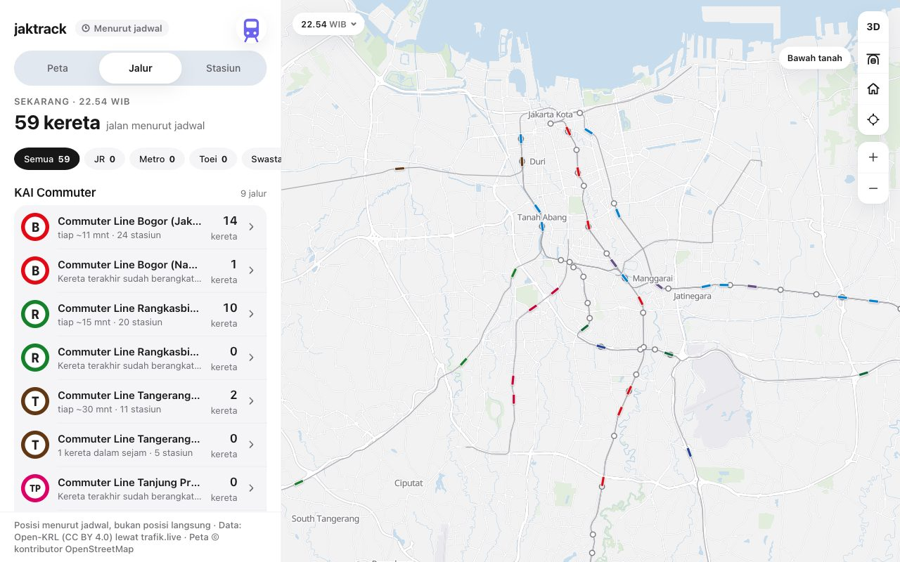
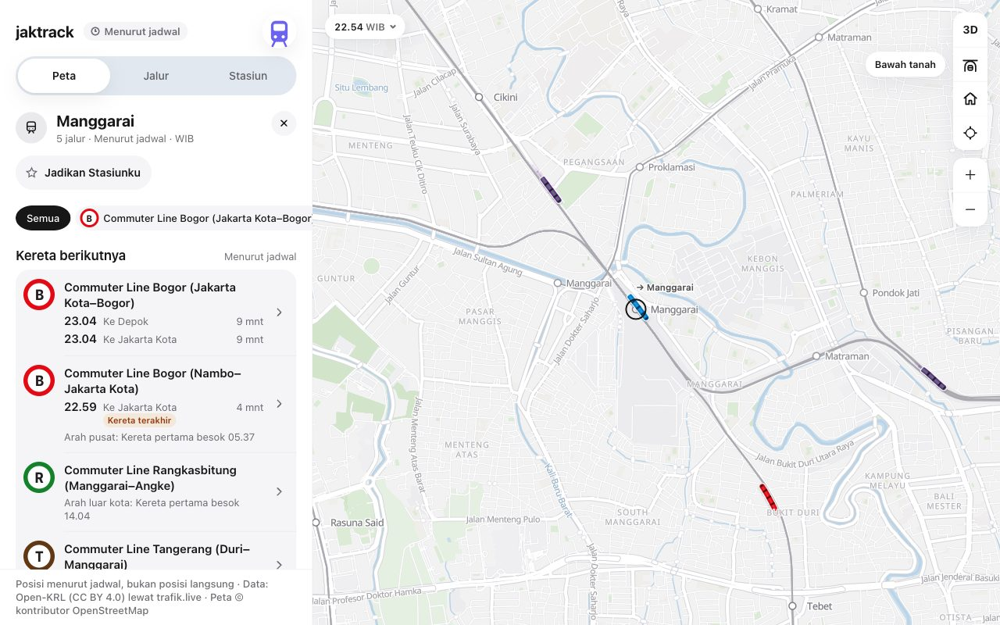
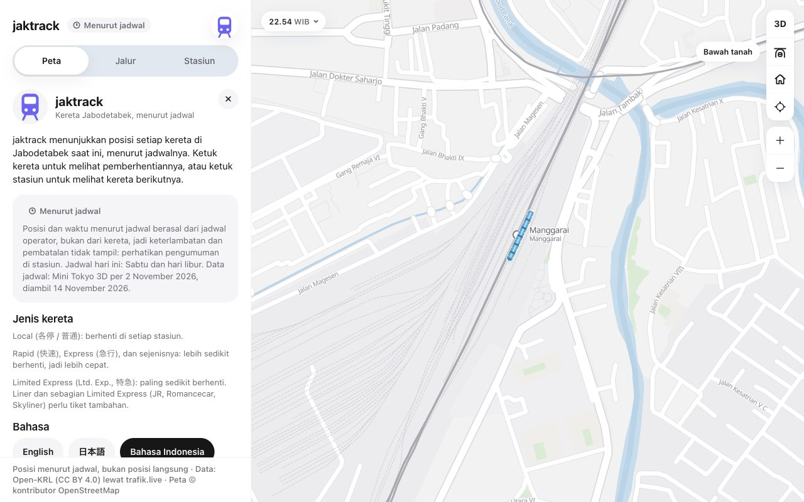
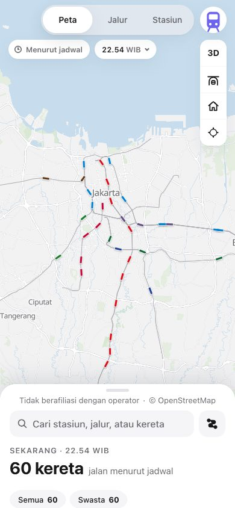

# jaktrack

Peta kereta Jabodetabek di browser: KRL Commuter Line, MRT Jakarta, LRT Jakarta, LRT Jabodebek, dan KA antarkota, masing-masing di posisi **menurut jadwalnya saat ini**.


> **Status: purwarupa.** Posisi kereta dihitung dari jadwal, **bukan posisi asli**. Keterlambatan dan pembatalan tidak terlihat.
> Halamannya adalah adaptasi [tokyo-rail-twin](https://github.com/lucacadalora/tokyo-rail-twin) (MIT) untuk Jakarta, dan belum seluruhnya disesuaikan (lihat [Yang belum disesuaikan](#yang-belum-disesuaikan)).

## Daftar isi

- [Tangkapan layar](#tangkapan-layar)
- [Fitur](#fitur)
- [Menjalankan](#menjalankan)
- [Data](#data)
- [Cara kerja](#cara-kerja)
- [Struktur repo](#struktur-repo)
- [Yang belum disesuaikan](#yang-belum-disesuaikan)
- [Riset trafik.live](#riset-trafiklive)
- [Lisensi dan asal kode](#lisensi-dan-asal-kode)
- [Penafian](#penafian)

## Tangkapan layar

Diambil 14 November 2026 sekitar pukul 22.55 WIB dari server dev lokal, dalam bahasa Indonesia.

| | |
|---|---|
| **Daftar jalur.** Tiap jalur dengan jumlah kereta yang sedang jalan dan jarak antar-kereta.<br> | **Papan stasiun.** Kereta berikutnya dari Manggarai per jalur dan arah, termasuk kereta terakhir.<br> |
| **Detail kereta.** KRL 1456 tujuan Depok: posisi sekarang, semua stasiun berikutnya, dan kamera yang mengikuti kereta.<br> | **Kota 3D.** Stasiun Manggarai dengan gedung 3D dan kereta di relnya.<br> |
| **Tentang.** Penjelasan "menurut jadwal", pilihan bahasa, serta sumber dan kredit data.<br> | **Ponsel.** Tata letak lembar bawah pada layar 390 × 844.<br> |

## Fitur

Sudah dicoba di browser dan berjalan:

- **Peta 2D** dengan setiap kereta bergerak di relnya, berwarna sesuai jalur. Sekitar 60–85 kereta pada malam hari.
- **Daftar jalur** dan **ringkasan per operator**.
- **Papan stasiun**: kereta berikutnya tiap arah, kereta pertama dan terakhir.
- **Detail kereta**: semua pemberhentian, posisi sekarang, dan mode mengikuti kereta.
- **Pencarian** stasiun, jalur, dan nomor kereta.
- **Kota 3D** dengan titik terbang ke Manggarai, Sudirman, Gambir, dan Jakarta Kota.
- **Bahasa** Indonesia (bawaan) dan Inggris.
- **Tata letak ponsel** dan desktop.

Ada di kode bawaan tokyo-rail-twin tetapi **belum diuji dengan data Jakarta**: perencana rute, pemutaran ulang waktu, tampilan bawah tanah, terbang bebas, mode luring (service worker), dan "kereta di dekatku".

Tidak ada: posisi langsung, bus TransJakarta, pintu keluar stasiun, tarif.

## Menjalankan

Butuh [Bun](https://bun.sh) 1.1 ke atas.

```bash
bun install
# 1. simpan berkas data kereta ke var/src/trafik/ (lihat bagian Data)
bun run data    # 2. bangun var/static/tokyo/ dari berkas itu
bun run dev     # 3. buka http://127.0.0.1:4776
```

Perintah lain:

| Perintah | Guna |
|---|---|
| `bun test` | Memeriksa berkas hasil `bun run data` dengan pembaca milik halaman web |
| `bun run build` | Situs statis di `web/dist` (±3,3 MB), bisa disajikan server web mana pun |

Tanpa langkah 1 dan 2, `bun run data` berhenti dengan pesan yang menyebut berkas yang kurang.

## Data

**Repo ini hanya berisi kode.** Berkas data tidak ikut di-commit (`var/` ada di `.gitignore`).

### Sumber

Satu berkas: `asset-krl-*.json` (±296 kB) yang dimuat halaman `trafik.live/kereta`. Isinya:

| Bagian | Asal menurut metadata berkas | Lisensi |
|---|---|---|
| Jadwal KRL Commuter Line | [Open-KRL](https://github.com/open-krl/pipeline), dari papan keberangkatan publik kci.id | CC BY 4.0 |
| Jadwal MRT, LRT Jakarta, LRT Jabodebek, KA antarkota | Dihimpun trafik.live | Tidak dinyatakan |
| Label LRT Jabodebek | Commute (ShioriLabs) | MIT |
| Koordinat stasiun | Kontributor OpenStreetMap | ODbL |
| Geometri rel | Tidak dinyatakan | Tidak dinyatakan |

### Cara mengambil

1. Buka `https://trafik.live/kereta` di browser.
2. Buka DevTools → tab Network, muat ulang halaman.
3. Simpan respons `asset-krl-<hash>.json` ke `var/src/trafik/`.

Tidak ada skrip unduh. Server trafik.live menolak klien selain browser (HTTP 403), dan repo ini tidak menyediakan alat untuk mengakalinya.

### Batasan pakai

- `robots.txt` trafik.live melarang pengumpulan konten untuk melatih model atau membangun dan menjual ulang korpus. Pakai berkas itu sebagai masukan lokal dan **jangan sebarkan ulang**.
- Bagian yang lisensinya tidak dinyatakan (jadwal MRT/LRT/KA antarkota dan geometri rel) belum jelas boleh dipakai ulang. Sebelum menayangkan jaktrack untuk umum, minta izin pengelolanya atau ganti dengan sumber terbuka.
- Untuk jadwal KRL saja, Open-KRL menerbitkan GTFS-nya langsung dengan lisensi CC BY 4.0.
- Atribusi tampil di halaman (Tentang → Data dan kredit) dan wajib dipertahankan.

### Hasil bangun

`bun run data` menghasilkan, dari berkas bertanggal bangun 12 Oktober 2026:

| | Jumlah |
|---|---|
| Jalur | 16 (dari 12 jalur sumber; jalur bercabang dipecah) |
| Stasiun | 207 entri, 50 kelompok pindah jalur |
| Perjalanan | 2.622: 2.133 pada hari kerja, 1.879 pada akhir pekan |

Angka ini berubah bila berkas sumbernya diperbarui.

## Cara kerja

```
asset-krl-*.json ─► data-build/jakarta.mjs ─► var/static/tokyo/ ─► web/ (MapLibre GL JS)
  (lokal, tidak        graf rel, lintasan,        network-v1.json     peta 2D, kota 3D,
   di-commit)          jadwal per jam             tt-v1/<kalender>/   papan, pencarian
```

**Pembangun data** (`data-build/jakarta.mjs`):

1. Membaca jalur, stasiun, potongan rel, pola pemberhentian, dan kereta dari berkas sumber. Waktu di sumber berselang 30 detik.
2. Menyusun graf rel, lalu mencari lintasan tiap kereta di antara pemberhentiannya (jalur terpendek).
3. Memecah tiap jalur sumber menjadi lintasan lurus. Jalur Bogor, misalnya, menjadi "Jakarta Kota–Bogor" dan "Nambo–Jakarta Kota".
4. Menulis jaringan (`network-v1.json`) dan jadwal yang dipotong per jam per kalender (`tt-v1/`), dalam format yang dibaca kode web.

**Halaman web** (`web/`):

- Memuat jaringan dan jadwal jam berjalan, lalu jam berikutnya sesuai kebutuhan.
- Menaruh tiap kereta di relnya dengan menginterpolasi di antara dua pemberhentian, setiap frame, langsung dari jam (tidak diakumulasi).
- Hari layanan berganti pukul 03.00 WIB; kereta lewat tengah malam tetap milik hari sebelumnya.
- Tidak ada server selain penyaji berkas statis. Peta dasar dari OpenFreeMap, tanpa kunci API.

## Struktur repo

| Jalur | Isi |
|---|---|
| `data-build/jakarta.mjs` | Pembangun data Jakarta |
| `data-build/jakarta.test.mjs` | Uji berkas hasil bangun |
| `web/tokyo.html`, `web/src/tokyo/` | Halaman dan modul fiturnya (peta, papan, pencarian, rute, i18n) |
| `web/src/layers/city3d/` | Kota 3D, bawah tanah, kamera |
| `web/src/map/`, `web/src/app/` | Mesin peta dan pembantu antarmuka |
| `web/build.mjs`, `web/dev-server.mjs` | Bundel esbuild dan server dev |
| `docs/media/` | Tangkapan layar README |
| `third_party/tokyo-rail-twin/` | Lisensi dan pemberitahuan kode asal |
| `KNOWLEDGE.md` | Catatan riset trafik.live |

Nama `tokyo` pada folder, berkas, dan jenis berkas data (`tokyo-network`) adalah bawaan kode asal dan sengaja belum diganti.

## Yang belum disesuaikan

- **Sisa Tokyo di antarmuka.** Kelompok operator "JR / Metro / Toei / Swasta", penjelasan jenis kereta Jepang di halaman Tentang, dan teks bahasa Jepang.
- **Jalur bercabang tampil sebagai beberapa jalur**, dan jalur yang berbagi rel digambar bertumpuk.
- **Hari libur nasional belum ada.** Hanya Sabtu dan Minggu yang memakai jadwal akhir pekan. Jadwal KRL hari Sabtu memakai tangkapan hari Minggu, karena sumbernya tidak punya tangkapan Sabtu.
- **Ketinggian rel dan kedalaman terowongan** memakai perkiraan bawaan, bukan data OpenStreetMap.
- **Stasiun bernama sama dengan id berbeda** (misalnya Dukuh Atas MRT dan LRT) belum digabung menjadi satu titik pindah.
- **Daftar "Pilih stasiunmu"** memakai id yang bergantung pada urutan jalur hasil bangun, jadi bisa bergeser bila data berubah.
- **Uji bawaan tokyo-rail-twin dihapus**, karena mengunci perilaku Tokyo (zona waktu JST, data Tokyo). Yang ada hanya uji berkas hasil bangun.
- **Bus TransJakarta** dari purwarupa pertama dilepas dulu. Kodenya ada di riwayat git (commit `e2ae3e6`): simulasi dari GTFS resmi `gtfs.transjakarta.co.id`.

## Riset trafik.live

Rancangan jaktrack berangkat dari mempelajari cara kerja [trafik.live](https://trafik.live). Catatan lengkapnya ada di [`KNOWLEDGE.md`](KNOWLEDGE.md). Ringkasnya:

- Posisi bus "live" di sana dibuat dari CCTV (deteksi YOLO, lalu model visi memutuskan apakah itu bus TransJakarta), bukan dari GPS armada. Saat diamati jalur itu mati dan petanya menampilkan simulasi dari jadwal.
- Kereta di sana sepenuhnya dari jadwal.
- Data dasarnya berasal dari sumber publik: GTFS TransJakarta, Open-KRL, dan OpenStreetMap.
- Protokol live-nya satu WebSocket: klien mengirim area peta, server membalas keadaan penuh lalu perubahan tiap detik.

Riset itu mencatat struktur dan bentuk data, dengan tiap butir ditandai teramati atau dugaan.

## Lisensi dan asal kode

- Kode di `web/` diadaptasi dari [tokyo-rail-twin](https://github.com/lucacadalora/tokyo-rail-twin) (MIT), yang sebagian diadaptasi dari [Mini Tokyo 3D](https://github.com/nagix/mini-tokyo-3d) karya Akihiko Kusanagi (MIT).
- Teks lisensi dan pemberitahuannya ada di `third_party/tokyo-rail-twin/` dan `web/public/LICENSES.txt`.
- Repo jaktrack sendiri belum mencantumkan berkas lisensi.
- Data tunduk pada lisensi sumbernya masing-masing (lihat [Data](#data)).

## Penafian

jaktrack tidak berafiliasi dengan trafik.live, tokyo-rail-twin, Open-KRL, KAI, KAI Commuter, MRT Jakarta, LRT Jakarta, TransJakarta, atau instansi pemilik data mana pun. Waktu yang tampil adalah waktu rencana. Untuk jadwal resmi dan gangguan layanan, pakai kanal resmi operator.
